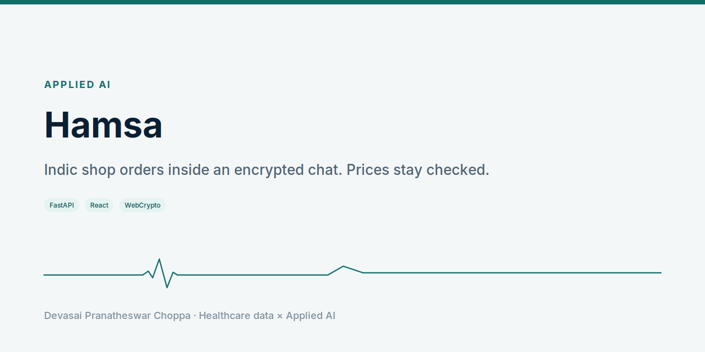
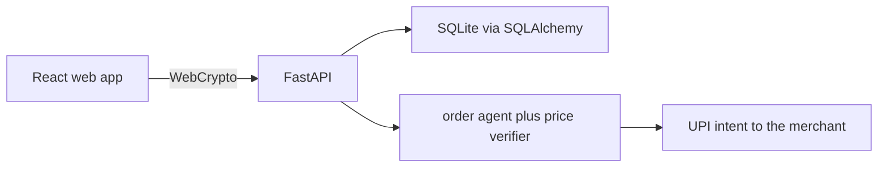

<picture>
  <source media="(prefers-color-scheme: dark)" srcset="docs/social-preview-dark.png">
  
</picture>

**An Indic shop agent inside an end-to-end encrypted chat. The app never holds the payment.**

<p align="center">
  
</p>

[Play the video](demo/hamsa-demo.mp4).

## Problem

A customer orders in Hindi, Tamil, or Hinglish. The cart still has to use the merchant's price, and the payment still has to go to the merchant.

## Solution

Personal and group chats encrypt in the browser with per-device P-256 keys and per-message AES-256-GCM. History stays on devices. A business link such as `/b/sharma-kirana` takes a guest order. The agent replies in English, Hindi, Hinglish, Marathi, Tamil, Tanglish, Telugu, or Bengali, and a verifier rejects prices the model invents. UPI is an intent and a QR to the merchant's UPI ID.

A model server is optional. With `HAMSA_LLM_BASE_URL` empty, the agent runs on rules.

## Architecture



Design and trust boundaries: `docs/architecture.md`.

## Tech stack

Python, FastAPI, SQLAlchemy, React, TypeScript, Vite, WebCrypto. An OpenAI-compatible model endpoint is optional.

## Quickstart

Requires Python 3.12, uv, and Node 22.

```bash
./scripts/dev.sh
```

The API listens on port 8000 and the web app on port 5173.

1. Open `http://localhost:5173/b/sharma-kirana` and order as a guest.
2. In a private window, sign in at `/login` as `98000 00001`. In development the OTP is shown on screen. Confirm the order under My business.
3. Sign in with another number and start an encrypted chat from New chat.

## Results

Backend tests cover OTP limits, the age gate, the encrypted relay, the ordering flow through UPI, stock reservation, and the LLM tier against a fake model. Web tests cover the encryption round-trip, tamper rejection, and non-extractable keys. No install count or revenue figure is claimed. Plan prices in the product copy are the design, not measured revenue.

## Roadmap

Not built: native iOS and Android apps, MLS in place of the v0 encryption, voice, and a hosted Postgres deployment. The order is in `docs/architecture.md`.

## License

No license file is in the repository yet. Add one before reuse.
